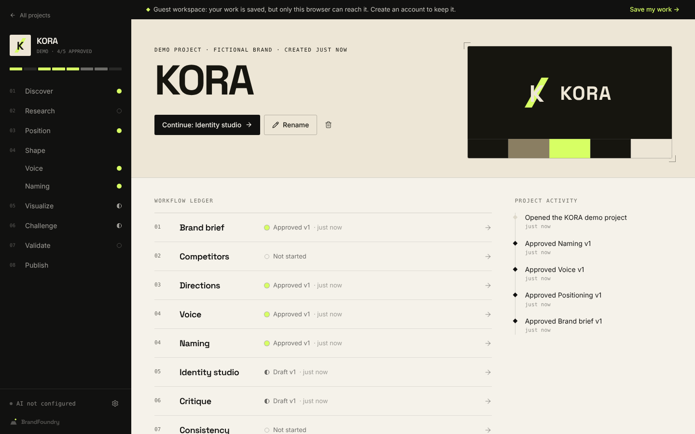
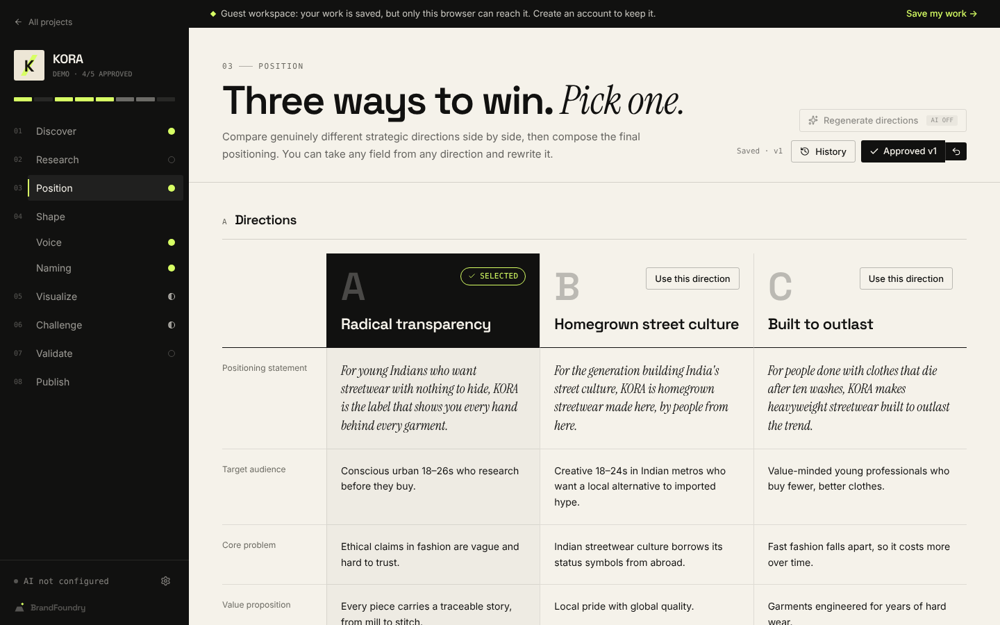
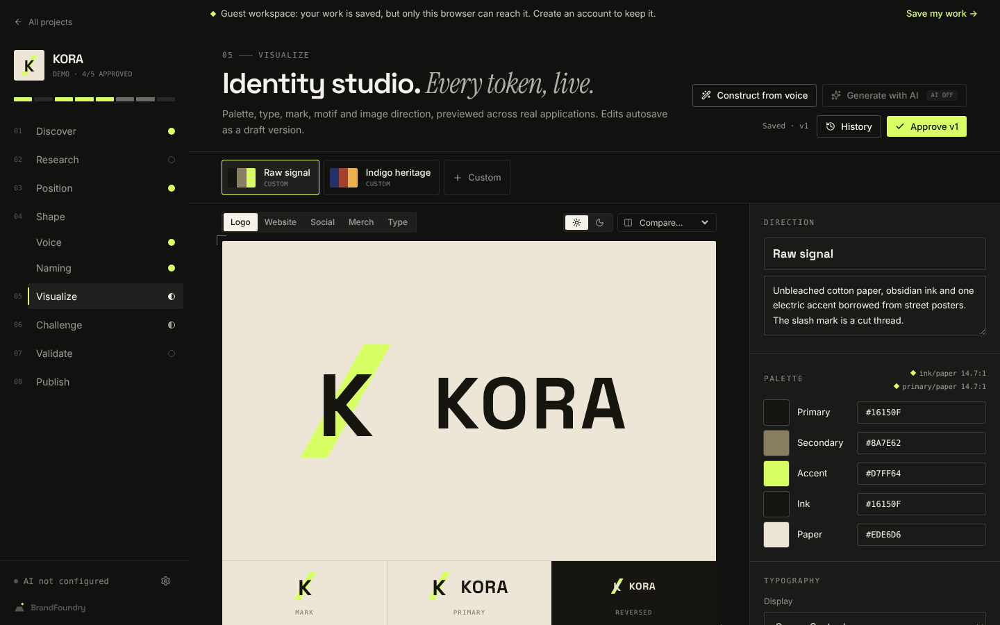
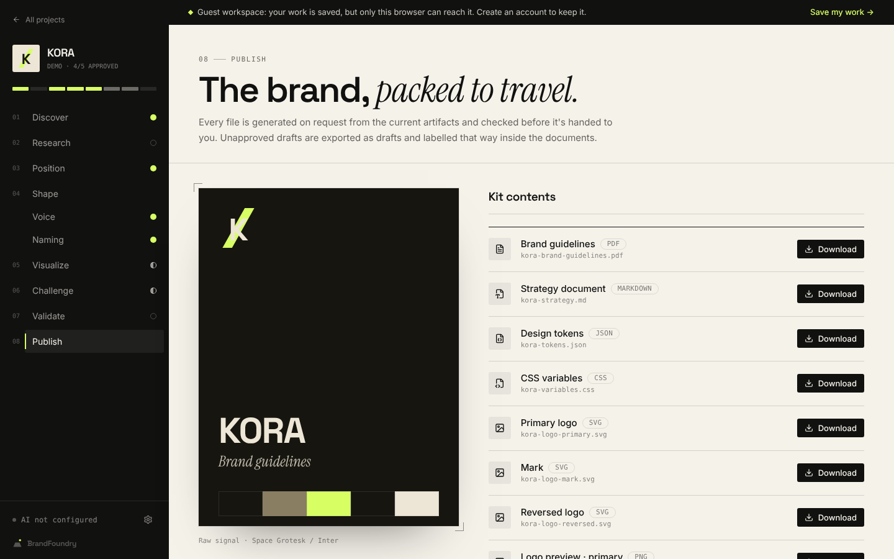
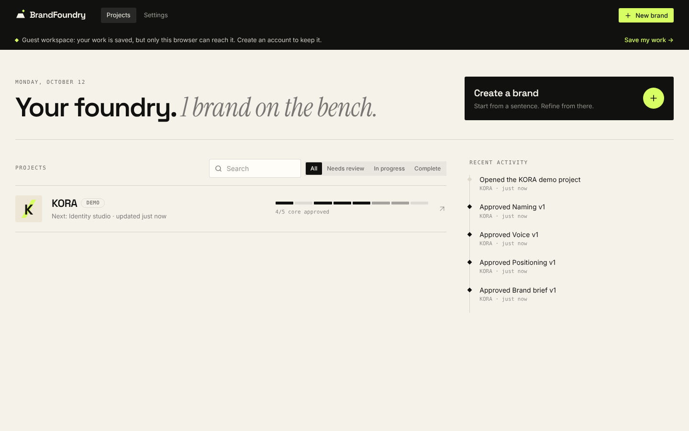
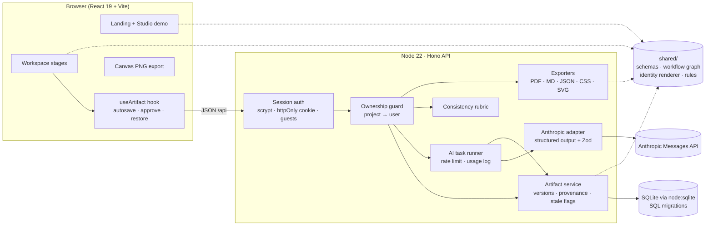

# BrandFoundry

**Build a brand that knows exactly what it stands for.**

BrandFoundry is a brand intelligence and identity workspace. It turns a rough business idea into a structured brief, competing strategic positions, a tone of voice, a name, a visual identity system, a critique, a consistency report and an exportable brand kit. All of these live in one connected, versioned workflow.



## The problem

Founders usually build a brand in disconnected pieces: a logo from one tool, copy from a chatbot, a palette from a moodboard. Nothing ties those decisions back to who the brand is for or what it promises, and nothing notices when one decision quietly contradicts another.

## What makes it different from a chatbot

BrandFoundry is **artifact-driven**, not conversation-driven.

- Each stage produces a structured, schema-validated **artifact**: brief, research, positioning, voice, naming, identity, critique or consistency report.
- Artifacts are **versioned**. Every version records its **provenance**: manual edit, AI (with the model name), rules, restore or demo. It also records the exact upstream versions it was built from.
- Downstream stages read **approved upstream artifacts**, not chat history.
- When an upstream artifact changes, every artifact that depends on it, directly or transitively, is flagged **Needs review**. Nothing is silently regenerated. You either mark it "Still valid", edit it, or regenerate it.
- Model output is treated as untrusted. It is validated with Zod, clamped, and re-validated by the artifact schema before it is stored.

## Features

| Stage | What you can do |
|---|---|
| **01 Discover** | Guided brief with progressive disclosure and a live brief document. AI follow-up questions and assumptions are kept separate from your facts until you accept them. Approval is blocked until the brief is complete. |
| **02 Research** | Comparison matrix of competitors you enter, plus evidence URLs. The AI analysis labels every pattern as "from your notes" or "hypothesis". No live web research, and the app says so. |
| **03 Position** | Three directions in a row-aligned comparison grid. Select one, take any field from any direction, and edit the final positioning. |
| **04 Shape** | Voice: four personality sliders, principles with do/don't lines, vocabulary, pillars, taglines and in-context copy. The voice checker runs instant rule checks plus an optional AI tone review. Naming: candidates, favourites, shortlist, rejection notes, and a chosen name. Availability is explicitly *not checked*. |
| **05 Visualize** | Identity studio: palette with live WCAG contrast readouts, typography, mark, wordmark, motif and image direction. Preview on logo, website, social, merch and type specimen, on light or dark backgrounds. Directions, saved variations, side-by-side compare, SVG download. "Construct from voice" builds three directions with deterministic rules when AI is off. |
| **06 Challenge** | Critique from four perspectives (customer, strategist, designer, investor). Each finding carries severity, evidence or judgment basis, the affected artifact, rationale and an action. Findings can be resolved or added by hand. |
| **07 Validate** | Nine published, deterministic rules (contrast, slider/personality conflicts, banned vocabulary, audience drift, stale approvals, approval order and more) plus an optional AI semantic review. Findings link to the conflicting artifacts and can be resolved or dismissed. |
| **08 Publish** | PDF guidelines, Markdown strategy, JSON tokens, CSS variables and an SVG logo set, all generated on the server. PNG logos are rasterised in the browser. Each file is fetched and size-checked before it is saved. |

The **dashboard** shows real project state: per-artifact workflow meters, items awaiting review, search and filters, and activity derived from persisted events. Visitors can start a project or open the fictional **KORA** demo without an account. A guest workspace is claimed by registering, and signing in moves guest projects into the account.

| Positioning | Identity studio |
|---|---|
|  |  |
| **Brand kit** | **Dashboard** |
|  |  |

All screenshots were captured from the running app in headless Chromium.

## Architecture



`shared/` is imported by both the client and the server. The same schemas validate input on both sides. The same SVG builder draws the in-app preview and the downloaded file. The same rubric runs live in the browser and is persisted by the server.

### Repository layout

```
server/        Hono app, auth, artifact service, AI adapter and tasks, exporters, migrations
shared/        Zod schemas, workflow graph, identity renderer, consistency rules, KORA demo data
src/landing/   Public landing page, hero transformation, studio demo
src/workspace/ Shell, stage pages, useArtifact hook
src/pages/     Auth, dashboard, new project, settings, legal, errors
tests/         Vitest (domain + API) and Playwright (end-to-end)
docs/          Plan, status, ADRs, screenshots
```

### Database design

`users` (guest or registered) → `sessions` (hashed tokens) → `projects` → `artifacts` (one per kind) → `artifact_versions` (JSON content + provenance) → `artifact_dependencies` (recorded upstream versions). Queryable side tables: `competitors`, `research_sources`, `naming_candidates`, `validation_findings`, `activity_events`, `ai_usage`. Every table uses foreign keys with cascade deletes, check constraints on enums, and indexes on the access paths. See [`server/migrations/001_init.sql`](server/migrations/001_init.sql).

### AI workflow

1. The client calls `POST /api/projects/:id/ai/:task`. The server checks ownership and the per-user rate limit, which is counted from the `ai_usage` table.
2. The task gathers **approved** upstream artifacts (or the current draft, flagged as such) and wraps user content in `<input>` tags, so it is treated as data.
3. The adapter calls `client.beta.messages.parse` with a Zod structured-output schema and adaptive thinking at `medium` effort. It also passes `fallbacks: "default"` on supported models. The SDK retries 408/409/429/5xx up to 2 times. One more attempt is made if the output fails validation. Refusals, truncation and invalid output are reported and never stored.
4. Output is clamped, re-validated against the artifact schema, and saved as a new version with provenance `{source: "ai", model, task, upstream}`. Downstream artifacts are flagged for review.
5. Every call is logged to `ai_usage` with its token counts and status.

Without `ANTHROPIC_API_KEY`, AI endpoints return `503 ai_not_configured`. The UI disables AI buttons with an "AI off" tag, and everything else still works.

## Running locally

Requires **Node 22.5+**, for the built-in `node:sqlite`.

```bash
npm install
cp .env.example .env        # optional: add ANTHROPIC_API_KEY
npm run dev                 # API on :8787, web on :5173 (proxied)
```

Open http://localhost:5173. Use **Explore Demo** for the seeded KORA project, or **Build Your Brand** to start a new one. No account and no AI key are needed for navigation, manual editing, approvals, validation or exports.

Production:

```bash
npm run build && npm start  # serves dist/ and the API on $PORT
```

### Environment variables

| Variable | Default | Purpose |
|---|---|---|
| `PORT` | `8787` | API (and static site in production) |
| `DATABASE_PATH` | `./data/brandfoundry.db` | SQLite file; created and migrated on start |
| `ANTHROPIC_API_KEY` | — | Enables AI generation (server-side only) |
| `ANTHROPIC_MODEL` | `claude-opus-5-5` | Model for all AI tasks |
| `AI_RATE_LIMIT` | `20` | AI requests per user per 10 minutes |
| `COOKIE_SECURE` | `false` | Set `true` behind HTTPS |

### Database migrations

Migrations in `server/migrations/*.sql` run automatically, in order, at startup. Applied files are recorded in `schema_migrations`. To add one, create `002_<name>.sql`. There's no separate migration command to run.

## Tests

```bash
npm run typecheck   # tsc
npm run lint        # eslint
npm test            # vitest: domain rules + API (auth, ownership, versions, invalidation, AI mocking, exports)
npm run test:e2e    # playwright: full visitor journey, demo + studio, route protection
```

The AI provider is injected, so tests use a fake provider and never call the live API. The end-to-end suite builds the app and runs it against a fresh database with AI unconfigured. If Playwright's bundled browser isn't installed, set `PLAYWRIGHT_CHROMIUM_PATH` to a local Chromium.

## Deployment

The app is one Node process with a SQLite file, so any host with a persistent disk works (Fly.io volume, Render disk, a VM):

1. `npm ci && npm run build`
2. Set `NODE_ENV=production`, `DATABASE_PATH` on the persistent volume, `COOKIE_SECURE=true`, and optionally `ANTHROPIC_API_KEY`.
3. `npm start`, with a TLS-terminating proxy in front.

Serverless platforms without a persistent disk need the Postgres path described in [ADR 0001](docs/adr/0001-sqlite-with-portable-schema.md).

## Security

- Passwords are hashed with scrypt (random salt, constant-time compare). Session tokens are random 256-bit values, stored only as SHA-256 hashes, in an `httpOnly`, `SameSite=Lax` cookie that is `Secure` when configured.
- Every project route resolves the project through `id AND user_id`. Projects owned by other users return **404**, so their ids can't be probed.
- Mutations must be `application/json`, which blocks cross-site form posts on top of SameSite cookies.
- Login is throttled per email (5 failures, then a 15-minute lockout). AI is rate-limited per user.
- The API key never leaves the server. Model output is validated before storage. User text in SVGs is XML-escaped. Colours are schema-validated hex values. Competitor URLs must be http(s) and open with `rel="noopener noreferrer nofollow"`.
- Changing a password revokes all other sessions. Deleting an account removes all of its data.

## Known limitations

- **No live market research.** Competitor intelligence uses what you enter. Anything else is labelled a hypothesis.
- **No image generation.** The configured provider (Anthropic) doesn't generate images. Identity directions are editable SVG/CSS systems, built by AI or by the rules-based constructor, and labelled by source.
- **No trademark or domain checks.** No availability provider is integrated, and the UI and exports say so.
- **PDF typefaces.** The guideline PDF embeds BrandFoundry's own fonts and names the brand's fonts. Wordmark specimens in the PDF use a stand-in face.
- **SQLite.** Fine for a single instance. Horizontal scaling needs Postgres (see ADR 0001).
- Guest workspaces are tied to one browser cookie and are purged after 30 days of inactivity.
- AI-assisted paths were tested with a mocked provider. A live API call was not made during development, because no key was configured in the build environment.

## Roadmap

- Postgres adapter with row-level security policies, for multi-instance deployment.
- A live research integration (web search with stored citations) behind a feature flag.
- Font-to-outline conversion, so exported SVGs and PDFs carry exact glyphs.
- Collaboration: share links, comments on artifacts, reviewer approvals.
- Image generation through a dedicated provider, stored as brand assets.

## Design notes

The visual language is "the creative foundry": obsidian and warm paper, with one electric chartreuse accent reserved for action, progress and approval. Display type is Space Grotesk, with Instrument Serif italics for editorial emphasis and Inter for the interface. Crop marks frame previews. A diamond "spark" is used consistently for state, from the slider thumbs and status glyphs to the logo itself. More in [`docs/adr`](docs/adr).
